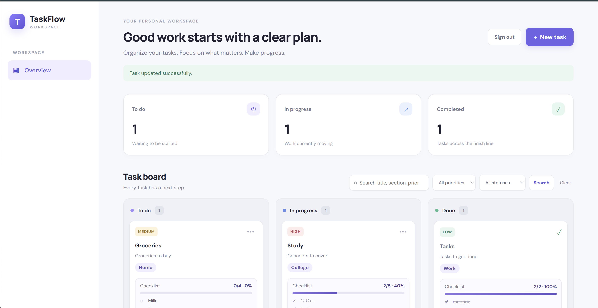
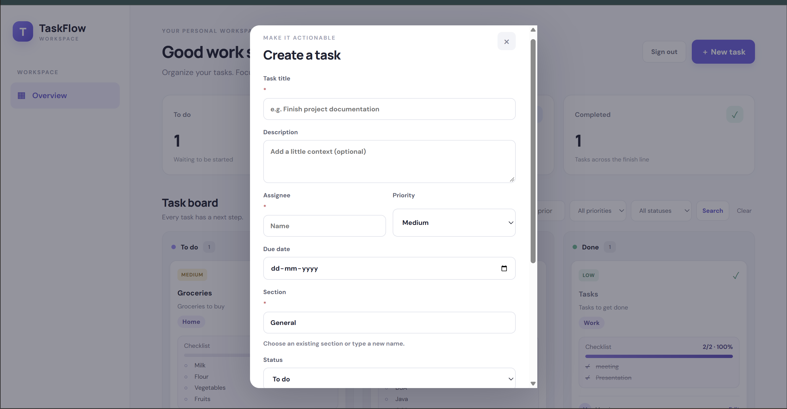
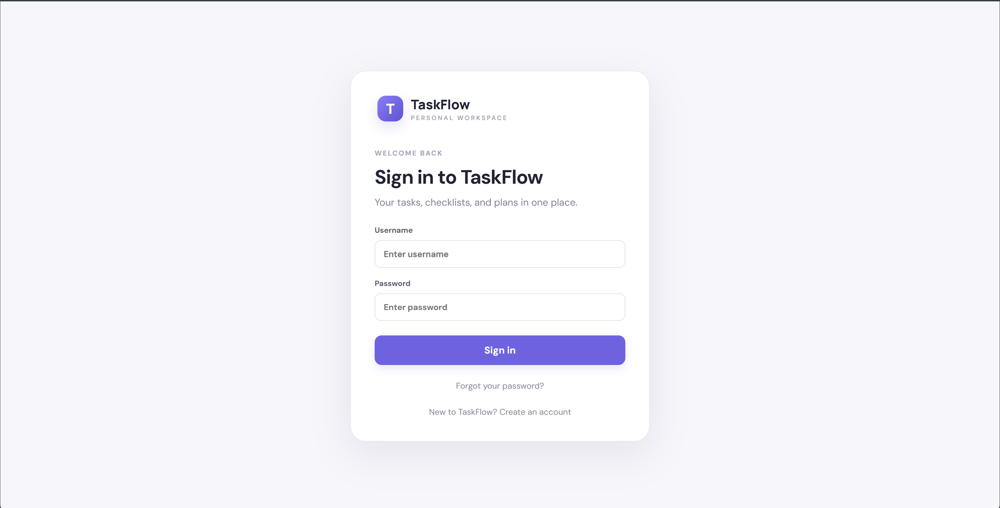
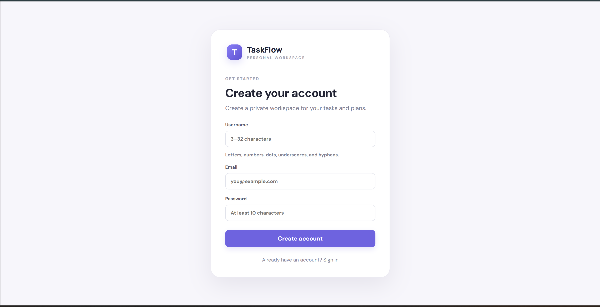

# TaskFlow — Personal Task Management

TaskFlow is a full-stack task management web application built with **Java 17, Spring Boot, Spring Security, Thymeleaf, and H2**. It helps users organize tasks, track progress, manage deadlines, and keep related work in one personal workspace.

The application runs locally and uses a file-based database, so you don't need a paid hosting service or cloud database to try it.

## Screenshots

### Task dashboard



### Create a task



### Sign in



### Create an account



## Features

- **Personal accounts:** register, sign in, and sign out, with BCrypt password hashing.
- **Task management:** create, edit, search, filter, reprioritize, and delete tasks.
- **Kanban board:** organize tasks into To do, In progress, and Done columns.
- **Custom sections:** group tasks by areas such as College, Work, or Home. Enter a new section name when creating or editing a task.
- **Due dates:** track deadlines and identify overdue tasks.
- **Checklists:** add checklist items, mark them complete, and view completion counts, percentages, and progress bars on task cards.
- **Completion confirmation:** receive a confirmation when marking a task complete while checklist items remain unfinished.
- **File attachments:** attach files to tasks, with a maximum upload size of 10 MB per file.
- **Drag and drop:** move tasks between board columns, with status and ordering saved.
- **Password recovery:** request email-based password-reset links when SMTP is configured. Reset tokens are stored as SHA-256 hashes, expire after 30 minutes, and are invalidated after use.
- **REST API:** perform task operations through authenticated API endpoints, with server-side ownership checks.
- **Persistent local storage:** save task data in an H2 file database and uploaded attachments on the local filesystem.
- **Authentication rate limiting:** apply configurable request limits to login, registration, forgot-password, and password-reset submissions.

## Technology stack

| Technology | Purpose |
|---|---|
| Java 17 | Application language and runtime baseline |
| Spring Boot | Application framework |
| Spring Security | Authentication and access control |
| Spring Data JPA / Hibernate | Database access and ORM |
| Thymeleaf | Server-rendered web pages |
| H2 Database | Local file-based database |
| Maven | Dependency management, build, and tests |
| HTML, CSS, JavaScript | User interface and browser interactions |
| JUnit, Mockito, MockMvc | Automated testing |

## Requirements

Install the following:

- **JDK 17 or newer**
- **Maven 3.8 or newer**
- Git
- Internet access for downloading the repository and Maven dependencies

Verify your Java and Maven installations:

```bash
java -version
mvn -version
git --version
```

Make sure Maven is using a compatible JDK. The project targets Java 17, so a newer compatible JDK can also be used.

## Clone and run locally

### 1. Clone the repository

Open a terminal and run:

```bash
git clone https://github.com/Mansi422-dot/TaskFlow.git
cd TaskFlow
```

### 2. Run the automated tests

```bash
mvn clean test
```

This cleans the previous build output and runs the project's automated tests. Confirm that Maven reports `BUILD SUCCESS` before proceeding.

### 3. Start the application

```bash
mvn spring-boot:run
```

Alternatively, on Linux or Kali, you can use the included launcher:

```bash
chmod +x run-taskflow.sh
./run-taskflow.sh
```

Use one startup method at a time. Wait for Spring Boot to finish starting before opening the application.

### 4. Open TaskFlow

Visit:

**http://localhost:8080**

If you are running the application in WSL, open the address in your Windows browser while the application is running.

### 5. Create an account

1. Open `/register` or select the account-creation link on the sign-in page.
2. Register with a username, email address, and password that meets the application's requirements.
3. Sign in at `/login`.
4. Create your first task using **New task**.
5. Add a due date, priority, section, checklist items, or attachment as needed.
6. Move tasks between board columns and use search or filters to find specific tasks.

A fresh local database is initialized as needed when the application starts.

## Password-reset email configuration (optional)

Email-based password recovery requires SMTP credentials. Without SMTP configuration, the application can display the generic forgot-password response, but it cannot deliver a reset email.

For Gmail, enable 2-Step Verification and create a Google App Password. Use the App Password rather than your normal Gmail password.

Set the following environment variables in the same terminal used to start the application:

```bash
export TASKFLOW_SMTP_HOST=smtp.gmail.com
export TASKFLOW_SMTP_PORT=587
export TASKFLOW_MAIL_USERNAME="your-email@gmail.com"
export TASKFLOW_MAIL_PASSWORD="your-16-character-app-password"
export TASKFLOW_MAIL_FROM="your-email@gmail.com"
export TASKFLOW_BASE_URL="http://localhost:8080"
```

Then start the application:

```bash
mvn spring-boot:run
```

Replace the example email address and password with your own values. Keep credentials private; never commit them to GitHub or put real secrets in this README.

The base URL shown above is for local development. If you change the port or local address, update the configuration accordingly.

## Data storage and backups

TaskFlow stores data locally by default.

- **Database:** `data/taskflow.mv.db`
- **Uploaded attachments:** `data/uploads/`

These files are generated locally and are not included in the Git repository.

To back up your data:

1. Stop the application.
2. Copy the entire `data/` directory to a safe location.
3. Keep the backup private, since it can contain account information, task details, and uploaded files.

Before replacing project files or changing the database schema, stop the application and back up `data/`. Do not delete this directory if you want to preserve your existing tasks and attachments.

## Security and privacy notes

- Passwords are hashed with BCrypt rather than stored as plaintext.
- Password-reset tokens are stored as SHA-256 hashes, expire after 30 minutes, and are invalidated after use.
- Task operations check ownership on the server so that one user's tasks are not accessible through another user's task operations.
- Authentication endpoints have configurable, in-memory rate limits. The default settings are 10 login attempts, 5 registration submissions, 3 forgot-password submissions, and 10 reset-password submissions per client IP per 15-minute window. Limits apply to POST requests to the corresponding endpoints.
- The default rate limiter uses the server-observed client IP address and is intended for a local portfolio application. It is not a substitute for a distributed rate-limiting system in a multi-instance production deployment.
- SMTP credentials should be provided through environment variables and kept out of version control.
- The current WSL-friendly configuration binds the server to `0.0.0.0`, allowing Windows to reach the application. This can also make it reachable through other network interfaces. Do not expose port 8080 to untrusted networks. For local-only use, restrict access through your host firewall or configure `server.address=127.0.0.1` if loopback access works in your environment.

**Important:** TaskFlow is a portfolio/demo application designed for local use. A public production deployment would require a security review and additional hardening, including HTTPS, secure secret management, production-grade rate limiting, monitoring, and an appropriately managed database.

## Project structure

```text
TaskFlow/
├── assets/                         # README screenshots
├── src/
│   ├── main/
│   │   ├── java/com/mansi/taskflow/
│   │   │   ├── model/              # Entities and domain models
│   │   │   ├── repository/         # Spring Data repositories
│   │   │   ├── service/            # Application services
│   │   │   └── web/                # Controllers, forms, and security
│   │   └── resources/
│   │       ├── templates/          # Thymeleaf HTML templates
│   │       ├── static/             # CSS and JavaScript
│   │       └── application.properties
│   └── test/java/com/mansi/taskflow/
│       ├── service/                # Service tests
│       └── web/                    # Web and API tests
├── .gitignore
├── pom.xml
├── README.md
└── run-taskflow.sh
```

## Troubleshooting

**Maven cannot resolve dependencies**

Check your internet connection and Maven installation, then retry:

```bash
mvn clean test
```

**Port 8080 is already in use**

Stop the other application using the port, or configure TaskFlow to use an available port.

**Password-reset email is not arriving**

Confirm that all required SMTP environment variables are set in the terminal from which TaskFlow is started. Check your SMTP provider's configuration and credentials.

**Tasks or attachments appear to be missing**

Confirm that you are using the same local project data directory and have not replaced or removed the `data/` folder. A fresh clone does not include another installation's database or uploaded files.

**The app works on one computer but not another**

Check the Java and Maven versions, follow the setup steps above, and inspect the terminal output for startup or database errors.

## Future improvements

Possible extensions include stronger integration tests, additional accessibility improvements, more advanced task organization, and production-oriented deployment hardening.

## License

No license is specified here. If you intend others to reuse, modify, or redistribute this project, consider adding a `LICENSE` file with the terms you choose.
